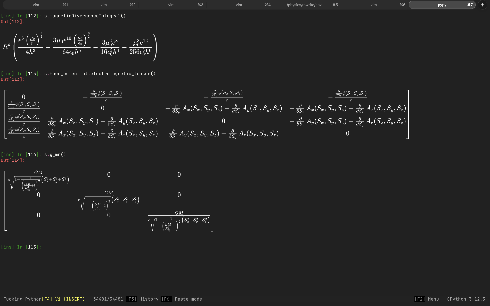

# Ghostty-PtPython Symbolic Math Renderer

This is a dead simple latex to katex to image script that is mostly used as part of a personal workflow that allows me to reliably work with symbolic math in the terminal. I never bothered to create a decent installation workflow, as this is really just something I built for myself, so the installation process is a little clunky. You only have to do everything once though.



To get the setup above, follow the following steps:

1. Install [Ghostty](https://github.com/ghostty-org/ghostty). Other terminals that have adopted the kitty protocol _might_ work, but Ghostty works for sure.
2. Clone this repository somewhere on your machine.
3. Copy the `python` directory's contents into your `$HOME/.jupyter/extensions/` directory. This will enable an extension called `mathcat`, but you havent loaded it yet.
4. Install [Rust](https://rust-lang.org/) if you don't have it installed already. This will enable the `cargo` command.
5. Run `cargo install --path <Path to wherever you put this repository>`. This will install the Rust portion of this plugin. Rust is doing the image conversion, and Python is just calling back and forth to the terminal.
6. Install [ptPython](https://github.com/prompt-toolkit/ptpython). This is an amazing ipython wrapper that renders the images in Ghostty flawlessly.
7. This step is optional, but if you don't do it you'll have to run it every time you open the terminal: In `$HOME/.ipython/profile_default/ipython_config.py`, add the following line (modify it if the `c.InteractiveShellApp.exec_lines` is already set)

```python

c.InteractiveShellApp.exec_lines = [
    "%load_ext icat",
    "%load_ext mathcat",
]
```

You can then set two properties through environment variables:

`IPYTHON_MATH_TRANSPARENT` and `IPYTHON_MATH_DARK_MODE`

Where both accept "1", "true", "yes" or "on"... or the opposite of course.

This package depends on [icat](https://github.com/Kabilan108/ipython-icat), so if your python installation doesn't automatically install the dependencies in your extensions folder, you'll have to run `pip install python-icat` from within your intended python environment.

---

As a bonus, if you want to you can render images like this:

```python
from enum import Enum
from typing import Self
from IPython.core.getipython import get_ipython
from PIL import Image
import pyperclip as pc


class Images(Enum):
    CristoffelDiagram = "cristoffel-diagram"
    FiveDimensionalGeometry = "5d-geometry-diagram"
    EquitemporalPlaneGeometry = "equitemporal-plane-geometry"
    CovariantDerivativeVsCristoffel = "covariant-derivative-vs-cristoffel"

    def to_path(self):
        if self == Images.CristoffelDiagram:
            return "/Users/bigsexy/Desktop/swift/Fluster/apps/website/public/assets/diagrams/ai_generated/cristoffel_symbols.png"
        if self == Images.FiveDimensionalGeometry:
            return "/Users/bigsexy/Desktop/swift/Fluster/apps/website/public/assets/diagrams/ai_generated/5dGeometry.png"
        if self == Images.EquitemporalPlaneGeometry:
            return "/Users/bigsexy/Desktop/swift/Fluster/apps/website/public/assets/diagrams/ai_generated/equi_temporal_plane_geometry.png"
        if self == Images.CovariantDerivativeVsCristoffel:
            return "/Users/bigsexy/Desktop/swift/Fluster/apps/website/public/assets/diagrams/ai_generated/covariant_derivative_and_the_cristoffel_symbol.png"
        return "Invalid Path"

    def copy_path(self):
        pc.copy(self.to_path())


def renderImage(img: Images, open=False):
    p = img.to_path()
    ipy = get_ipython()
    if ipy is not None:
        ipy.run_line_magic("icat", p)
    if open:
        img = Image.open(p)  # pyright: ignore
        img.show()  # pyright: ignore
```

Of course using an enum is a design decision. Use a string if that fits your workflow better. This is really just calling the icat magick programmatically, but I found this much easier to work with in the terminal.

Then just call it in one of your notebook cells:

```python
renderImage(Images.CristoffelDiagram)
```
